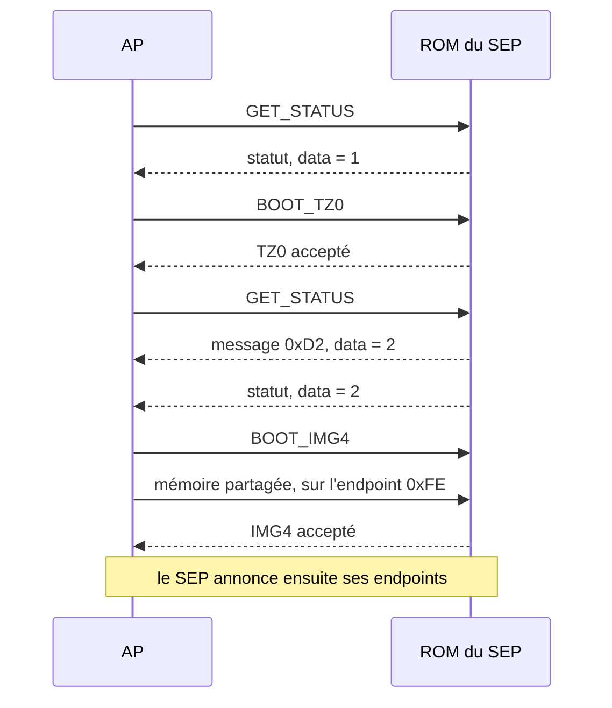
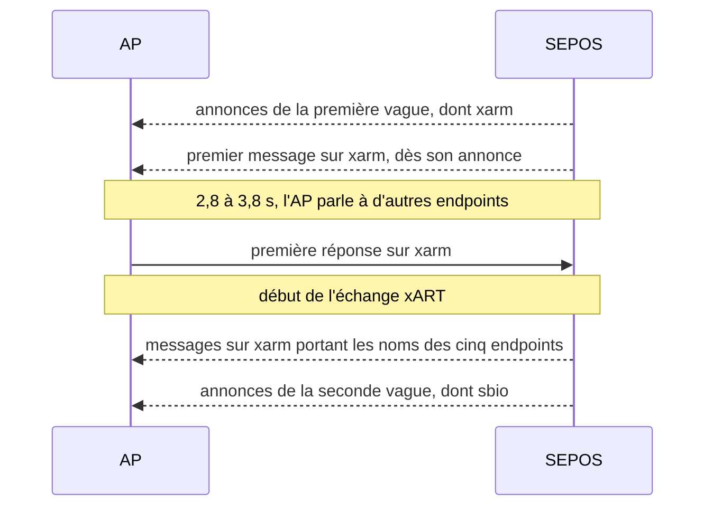

# Démarrage du SEP

Le SEP, ou Secure Enclave Processor, est le coprocesseur de sécurité de la puce. Sous macOS,
ses services n'apparaissent qu'après une séquence de démarrage menée par l'AP, c'est-à-dire
par les cœurs qui exécutent macOS ou Linux : l'AP envoie quelques messages, puis écoute la
liste des services que le SEP annonce. Le service biométrique dont Touch ID, le
déverrouillage par empreinte, a besoin fait partie de cette liste, mais pas tout de suite.
Ce chapitre décrit la séquence de démarrage, ce que le SEP annonce ensuite, et à quel
endroit Linux reste aujourd'hui bloqué.

Tout ce qui suit a été observé sur un MacBook Pro 14 pouces à puce M1 Max, appelé plus bas
« la machine étudiée ».

## Qui démarre le SEP

Pour faire fonctionner Touch ID, Linux devra démarrer le SEP lui-même, ou le faire démarrer
avant lui. Il faut donc savoir qui fait quoi.

Le SEP exécute d'abord une **ROM**, un petit programme de démarrage qui répond à quelques
messages. Les services utiles, dont la biométrie et la gestion des clés, sont
fournis par **SEPOS**, le système complet du SEP. SEPOS est contenu dans un fichier appelé
firmware du SEP, et il n'est en fonction qu'une fois ce firmware chargé.

D'après la documentation publique d'Asahi Linux, le travail est réparti ainsi :

1. iBoot, le chargeur de démarrage d'Apple, copie le firmware du SEP en mémoire et note son
   emplacement dans l'ADT. L'ADT, ou Apple Device Tree, est la description du matériel
   transmise au système.
2. Le système d'exploitation démarre le SEP en lui envoyant quelques messages, dont l'un
   désigne ce firmware déjà en mémoire. Le SEP vérifie lui-même son firmware avant de
   l'exécuter.

Sous macOS, c'est le noyau qui envoie ces messages. Sous Linux, quelqu'un devra le faire à
sa place. Le code public contient déjà de quoi envoyer cette séquence : dans m1n1, le
chargeur de démarrage du projet Asahi Linux, et dans un pilote minimal du noyau linux-asahi,
le noyau Linux maintenu par ce projet. Mais ce pilote ne sert pas sur la machine étudiée :
dans le device tree public, qui est la description du matériel utilisée par Linux, l'entrée
qui décrit le SEP est désactivée.

<!-- QUESTION ALBERT : dans la cible visée, qui doit démarrer le SEP : m1n1 avant de lancer Linux, ou un pilote du noyau Linux ? Les sources décrivent les deux possibilités sans trancher. -->

## La séquence de démarrage

Cette séquence est celle que macOS envoie : c'est le modèle dont dispose un pilote Linux.
Elle montre ce que macOS fait, pas ce que le SEP exige ; les écarts connus avec la séquence
de m1n1 sont signalés au passage.

L'AP et le SEP se parlent par une **mailbox**, un mécanisme matériel où chacun dépose des
messages pour l'autre. Chaque message est un mot de 64 bits. Quatre de ses champs servent
dans ce chapitre : l'**endpoint**, numéro du service visé ; le type, qui désigne
l'opération ; et deux valeurs libres appelées *param*, sur 8 bits, et *data*, sur 32 bits.
Le format complet est décrit dans [Architecture AP ↔ SEP](02-architecture.md).

Deux endpoints servent au démarrage. La ROM répond sur l'endpoint 0xFF. L'endpoint 0xFE
sert à indiquer au SEP sa **mémoire partagée**, une zone de mémoire que l'AP met à sa
disposition. La documentation Asahi répartit ces deux rôles un peu autrement ; on suit ici
le code de m1n1 et les captures, qui concordent.

Les noms des messages viennent du code public de m1n1. La séquence ci-dessous est celle que
macOS envoie. Elle a été relevée en faisant tourner macOS 13.5 sous l'hyperviseur de m1n1,
c'est-à-dire avec m1n1 qui exécute macOS comme un invité et enregistre ses échanges avec le
SEP. Ce montage est décrit en [S1](annexe-sources.md#s1). Un enregistrement fait ainsi
s'appelle une capture. La séquence est lue dans la capture
[T-03](annexe-sources.md#t-03) et se retrouve à l'identique dans la capture
[T-16](annexe-sources.md#t-16).

| Étape | Sens | Endpoint | Type | Nom | Rôle |
|---|---|---|---|---|---|
| 1 | AP → SEP | 0xFF | 0x02 | GET_STATUS | demande son état à la ROM |
| | SEP → AP | 0xFF | 0x66 | statut | réponse ; data vaut 1 à ce stade |
| 2 | AP → SEP | 0xFF | 0x05 | BOOT_TZ0 | lance l'étape que le code public appelle TZ0 |
| | SEP → AP | 0xFF | 0x69 | TZ0 accepté | accusé de réception de l'étape TZ0 |
| 3 | AP → SEP | 0xFF | 0x02 | GET_STATUS | seconde demande d'état |
| | SEP → AP | 0xFF | 0xD2 | BOOT_UNK_DONE | nom donné par m1n1, qui l'attend après BOOT_TZ0 sans en connaître le rôle ; data vaut 2 |
| | SEP → AP | 0xFF | 0x66 | statut | data vaut 2 |
| 4 | AP → SEP | 0xFF | 0x06 | BOOT_IMG4 | désigne le firmware à exécuter ; IMG4 est le format de conteneur de ce firmware |
| 5 | AP → SEP | 0xFE | voir plus bas | mémoire partagée | indique au SEP où se trouve sa mémoire partagée |
| | SEP → AP | 0xFF | 0x6A | IMG4 accepté | accusé de réception de BOOT_IMG4 ; les annonces d'endpoints suivent |

Sur l'étape TZ0, nos sources disent peu de chose. La documentation Asahi décrit le message
correspondant comme faisant passer le SEP dans une seconde phase de démarrage, pour laquelle
une portion de mémoire lui est réservée.

Le journal du noyau macOS, enregistré dans la même capture, contient deux lignes qui
correspondent à ces étapes : « SEP accepted Tz0 » pour la réponse 0x69 et « SEP accepted
IMG4 » pour la réponse 0x6A. Ce journal n'est pas horodaté.

Dans le code public de m1n1, le champ data de BOOT_IMG4 et celui du message de mémoire
partagée portent chacun une adresse, exprimée en pages de 4 Kio, donc divisée par 0x1000.
Ce sont des adresses telles que le SEP les voit, à travers son IOMMU : l'unité de
traduction d'adresses placée entre un périphérique et la mémoire, que les puces Apple
appellent DART. Ce qu'on observe sous macOS s'accorde avec cette lecture, sans la prouver.

- Dans BOOT_IMG4, macOS envoie la valeur 4, soit l'adresse 0x4000 si le champ a le même
  sens que dans m1n1.
- Dans le message de mémoire partagée, macOS envoie 0x580, et le journal de son noyau
  indique que la mémoire partagée se trouve à l'adresse 0x580000 du côté du SEP.

> **Hypothèse** — La valeur *data* des réponses de statut, 1 puis 2, est un numéro d'étape
> que l'AP contrôle avant de continuer. Ce qui la soutient : la lecture du code des
> extensions noyau de macOS, et la ligne « SEP status: 2 » du journal du noyau. Ce qui
> manque : aucune expérience ne montre ce qui se passe quand la valeur est différente.

### Le message de mémoire partagée diffère entre macOS et m1n1

Sur l'endpoint 0xFE, m1n1 envoie un message de type 0x18, qu'il appelle SET_SHMEM. Dans la
capture [T-03](annexe-sources.md#t-03), macOS envoie au même endroit un message dont le
champ type vaut 0x1C. Pour qui écrit un pilote, la question est de savoir quelle valeur
mettre.

> **Hypothèse** — Cette valeur n'est pas un numéro d'opération mais la taille de la mémoire
> partagée, en pages de 4 Kio, écrite sur 16 bits à cheval sur les champs type et param. Ce
> qui la soutient : la lecture du code des extensions noyau de macOS, et le fait que 0x1C
> pages font 0x1C000 octets, la taille que le journal du noyau macOS donne pour cette
> mémoire dans la capture [T-16](annexe-sources.md#t-16). Le 0x18 de m1n1 serait alors une
> taille de 0x18000 octets. Ce qui manque : le recoupement avec le journal du noyau n'a été
> fait que sur une capture, et rien n'a été testé du côté de m1n1.

## L'annonce des endpoints

Un pilote ne peut pas deviner à quel numéro envoyer les commandes biométriques : il doit
l'apprendre du SEP. Une fois la séquence de démarrage terminée, le SEP annonce lui-même ses services sur
l'endpoint 0xFD. L'AP n'a rien à demander, il lui suffit de lire.

Chaque endpoint donne lieu à deux messages du SEP vers l'AP :

| Type | Champ param | Champ data | Rôle |
|---|---|---|---|
| 0x00 | numéro de l'endpoint | nom sur quatre caractères ASCII | associe un nom à un numéro |
| 0x01 | numéro de l'endpoint | quatre octets | tailles des buffers OOL de cet endpoint, selon l'hypothèse ci-dessous |

Sur la machine étudiée, douze endpoints sont annoncés, et ce sont les douze que liste la
documentation Asahi. Trois comptent dans ce chapitre : `sbio`, le service biométrique ;
`xarm`, qui gère xART, décrit par la documentation Asahi comme le « coffre » par lequel le
SEP confie des données à l'AP d'un démarrage à l'autre ; et `cntl`, l'endpoint de contrôle,
par lequel l'AP active les autres endpoints. Le rôle des neuf autres est donné dans
[Carte des endpoints](04-endpoints.md).

**L'ordre d'annonce n'est pas fixe.** Huit démarrages de macOS ont été comparés, ceux de la
série [T-G2](annexe-sources.md#t-g2) : les douze mêmes noms sont toujours annoncés, avec les
mêmes numéros, mais dans trois ordres différents. Un pilote doit donc retrouver chaque
endpoint par son nom, jamais par son rang d'arrivée.

Le message de type 0x01 concerne les **buffers OOL**. Les données trop volumineuses pour un
message sont déposées dans un buffer en mémoire, dit OOL pour *out of line*. Sous macOS, on
voit l'AP envoyer sur `cntl`, pour neuf des douze endpoints, quatre messages qui donnent
deux tailles et deux adresses.

> **Hypothèse** — Ces quatre messages sur `cntl` attribuent à l'endpoint deux buffers OOL,
> l'un pour l'envoi, l'autre pour la réception. Les quatre octets du message de type 0x01
> sont alors, dans l'ordre : le nombre minimal et maximal de pages pour le buffer d'envoi,
> puis pour le buffer de réception. Attention, la page vaut ici 0x4000 octets, et non 4 Kio comme pour les
> adresses. Ce qui la soutient : la lecture du code des extensions noyau de macOS, et le
> fait que les tailles que macOS attribue ensuite aux buffers correspondent aux deux
> maximums dans les 67 attributions relevées sur ces huit démarrages. Ce qui manque : la
> règle a été lue dans le code avant d'être confrontée aux captures ; ce n'est pas une
> prédiction faite à l'aveugle.

## Deux vagues d'annonces

Les douze endpoints n'arrivent pas ensemble, et `sbio` ne fait pas partie des premiers :
c'est le point qui compte le plus pour Touch ID. Voici ce que montrent les 19 démarrages de
macOS observés, ceux de la série [T-G1](annexe-sources.md#t-g1).

- **Sept endpoints sont annoncés d'abord** : `cntl`, `hdcp`, `xars`, `xarm`, `hibe`, `pnon`,
  `stac`. Ils arrivent sans que l'AP ait rien envoyé en dehors des messages de démarrage.
  Dans la capture [T-03](annexe-sources.md#t-03), les sept annonces tiennent en 7 ms.
- **Les cinq autres arrivent environ trois secondes plus tard** : `sbio`, `skdl`, `sse`,
  `sks` et `scrd`, dans un ordre qui varie. Dans les 19 démarrages, ils sont annoncés après
  la première réponse de l'AP sur `xarm`.

Entre les deux, le SEP émet un premier message sur `xarm` dès qu'il l'a annoncé, et l'AP
met entre 2,8 et 3,8 secondes à y répondre, selon les démarrages. Pendant ce temps, l'AP
envoie déjà des messages sur `cntl` et sur deux autres endpoints de la première vague.
L'échange xART s'engage ensuite. Au cours de cet échange, le SEP envoie sur `xarm` cinq
messages dont le champ data contient chacun les premières lettres du nom d'un des cinq
endpoints. Dans la capture [T-03](annexe-sources.md#t-03), celui qui porte le nom de `sbio`
précède l'annonce de `sbio` d'un dixième de milliseconde.

Le détail de cet échange est décrit dans [Le coffre xART](05-xart.md).

## Démarrer le SEP sans macOS

Pour que Linux utilise le SEP, il faut que la séquence fonctionne sans macOS. Elle a été
essayée avec m1n1 seul, sans aucun système sur le Mac : m1n1 attend alors les ordres d'un PC
relié par USB. Ce montage est décrit en [S2](annexe-sources.md#s2).

**Les compteurs de la mailbox ne sont pas à zéro.** Dans l'essai
[T-23](annexe-sources.md#t-23), les registres de la mailbox sont lus sans rien envoyer. Les
boîtes sont vides, mais leurs compteurs de lecture et d'écriture ne sont pas à zéro, ce qui
suggère que des messages ont déjà circulé avant que m1n1 n'intervienne. On ne peut pas en
déduire si SEPOS tourne déjà ou non.

**Le SEP répond sur l'endpoint de la ROM.** m1n1 sait demander des octets aléatoires au SEP par le message GETRAND,
de type 0x10 sur l'endpoint 0xFF. Dans l'essai [T-28](annexe-sources.md#t-28), le SEP
renvoie quatre octets. La mailbox fonctionne donc sans macOS. Cela ne dit pas si SEPOS
tourne : la documentation publique attribue cet endpoint à la ROM.

**m1n1 reçoit les réponses qu'il attend.** Dans l'essai [T-30](annexe-sources.md#t-30), du
9 novembre 2026, m1n1 envoie sa séquence publique avec le firmware qu'iBoot a laissé en
mémoire : GET_STATUS, BOOT_TZ0, GET_STATUS, BOOT_IMG4 et SET_SHMEM. Il reçoit les
quatre réponses qu'il attend ; le relevé de l'essai ne les détaille pas une à une. Pendant les
30 secondes d'écoute qui suivent :

- le SEP annonce **sept endpoints sur douze** : `cntl`, `hdcp`, `xars`, `xarm`, `hibe`,
  `pnon`, `stac`, soit exactement la première vague de macOS ;
- `sbio`, `sks`, `scrd`, `sse` et `skdl` n'apparaissent pas ;
- quatre messages du SEP restent non lus, trois sur `cntl` et un sur `xarm`. Leur contenu
  n'a pas été enregistré.

Le SEP démarré depuis m1n1 annonce donc les mêmes endpoints que la première vague de macOS,
et pas le service biométrique.

> **Hypothèse** — SEPOS a bien démarré lors de cet essai. Ce qui la soutient : les annonces
> d'endpoints, qui sous macOS suivent la séquence de démarrage. Ce qui manque : un seul
> essai, et on ne peut pas exclure un état dégradé si le SEP avait déjà été démarré avant.

Un piège d'outillage est à connaître. Avec le commit de m1n1 indiqué dans
l'[annexe](annexe-sources.md), un premier essai le même jour a fait planter m1n1 avant
l'envoi du moindre message. L'explication retenue est que le code Python public de
démarrage du SEP déclare le DART sous un mauvais modèle. L'essai réussi indique
explicitement le modèle de DART de cette puce, que le code public nomme `t6000`.

<!-- QUESTION ALBERT : ce premier essai raté correspond-il au dossier traces/20261109-220855_sep_boot, catalogué T-29 dans l'annexe ? Le journal dit qu'il n'a pas laissé de dossier. Tant que ce n'est pas confirmé, le chapitre ne cite pas T-29. -->

> **Hypothèse** — Les cinq endpoints manquants, dont `sbio`, ne sont annoncés qu'une fois
> l'échange xART mené par l'AP ; sous m1n1 personne ne tient cet échange, et le SEP en reste
> à sept. Ce qui la soutient : l'ordre observé dans les 19 démarrages de macOS, et le
> fait que le SEP nomme ces cinq endpoints sur `xarm` pendant l'échange. Ce qui manque : c'est
> une succession, pas une preuve de cause. Six autres explications restent possibles. Sous
> macOS, l'AP a aussi envoyé des messages sur `cntl` et sur deux autres endpoints avant la
> seconde vague, et m1n1 n'en a envoyé aucun. L'un des quatre messages non lus attendait
> peut-être une réponse. Le message de mémoire partagée de m1n1 n'est pas celui de macOS.
> Le SEP avait peut-être déjà été démarré avant l'essai. Le script d'essai a pu perturber
> la suite en ne lisant pas tous les messages. Enfin, 30 secondes d'écoute étaient
> peut-être trop courtes, ce qui est peu probable puisque macOS obtient la seconde vague en
> trois à quatre secondes. Une partie de ces explications peut s'examiner sur les captures
> existantes ; séparer le rôle de `cntl` de celui de xART demande de répondre au SEP depuis
> m1n1, donc de refaire l'essai dont l'encadré suivant décrit le risque.

> ⚠️ **Éviter de démarrer le SEP depuis m1n1.** Lors du seul essai, le 9 novembre 2026,
> macOS a exigé une reconnexion au compte Apple au redémarrage suivant. La cause n'est pas
> établie : aucune demande de ce genre n'avait été signalée après la vingtaine de captures
> faites auparavant sous hyperviseur, et deux redémarrages normaux de macOS, faits ensuite dans le montage
> [S4](annexe-sources.md#s4), se sont passés sans nouvelle demande. Tant qu'on ne sait pas,
> on considère ce démarrage comme risqué pour l'état de macOS. Voir
> [Règles et risques](10-regles-et-risques.md).

## À retenir

- Sous macOS, l'AP démarre le SEP : il envoie GET_STATUS, BOOT_TZ0, GET_STATUS, BOOT_IMG4 et un
  message de mémoire partagée, puis le SEP annonce ses endpoints.
- Les endpoints se cherchent par leur nom dans les annonces de l'endpoint 0xFD : l'ordre
  d'arrivée n'est pas garanti.
- Sept endpoints sont annoncés d'emblée ; `sbio`, nécessaire à Touch ID, fait partie des
  cinq qui n'arrivent, sous macOS, qu'après le début de l'échange xART.
- Depuis m1n1, sans macOS, la séquence de démarrage donne les sept premiers endpoints, pas
  `sbio`. Sans `sbio`, pas de Touch ID : c'est là que Linux est arrêté aujourd'hui.
- Ce démarrage depuis m1n1 n'a été fait qu'une fois et a été suivi d'un effet inexpliqué sur
  macOS.

## Questions ouvertes

- Avant le premier GET_STATUS, macOS envoie sur l'endpoint 0xFF un message de type 0x1B,
  auquel le SEP répond par un type 0x7F. On le voit dans les captures
  [T-03](annexe-sources.md#t-03) et [T-16](annexe-sources.md#t-16). Ce couple est absent du
  code public de m1n1, le code des extensions noyau de macOS ne montre pas d'où il part, et
  le démarrage depuis m1n1 a été accepté sans lui. Son rôle est inconnu.
- À quoi sert le message 0xD2 que le SEP envoie pendant la séquence ? D'après le code des
  extensions noyau de macOS, il porterait lui aussi un statut.
- Que contenaient les quatre messages restés non lus après le démarrage depuis m1n1 ? Sous
  macOS, au même stade, le SEP a émis un message sur `xarm` et deux ou trois sur `cntl` ;
  rien ne prouve que ce soient les mêmes.
- SEPOS tourne-t-il déjà quand m1n1 prend la main, avant toute séquence de démarrage ? La
  documentation publique dit qu'iBoot ne fait que copier le firmware, ce qui laisse penser
  que non, mais aucune source ne l'écrit.
- Quelle valeur faut-il mettre dans le message de mémoire partagée, et la différence entre
  m1n1 et macOS a-t-elle une conséquence ?
- Pourquoi macOS a-t-il demandé une reconnexion au compte Apple après le démarrage du SEP
  depuis m1n1 ?
