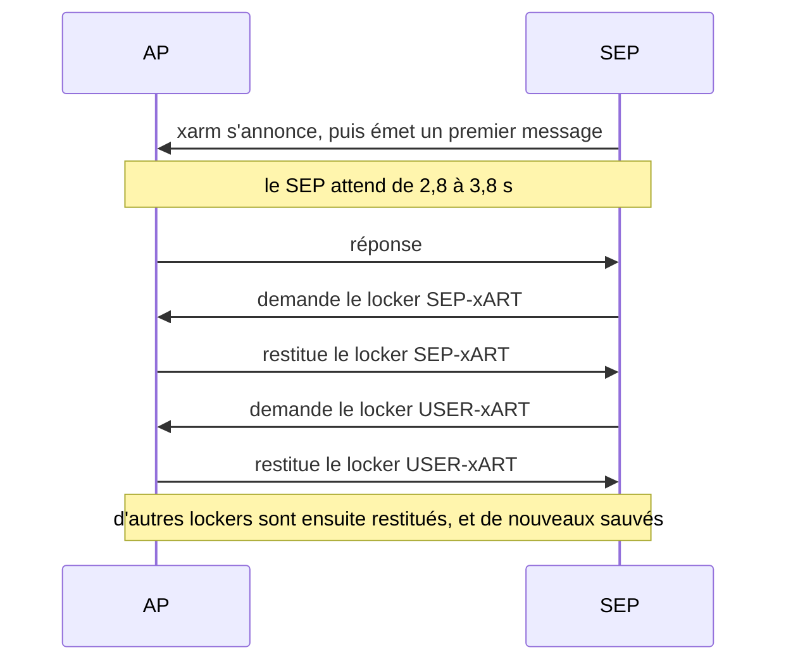

# Le coffre xART

Le SEP, le coprocesseur de sécurité de la puce, n'a pas de stockage persistant à lui. Il confie des lockers, des blocs de données chiffrés, à l'AP, le côté qui exécute le système d'exploitation, macOS ou Linux ; l'AP les range sur le disque et les lui rend au démarrage suivant. Ce mécanisme s'appelle xART. L'ensemble de ces lockers forme ce qu'on appellera ici le coffre. Il compte pour Touch ID sous Linux parce que l'endpoint biométrique `sbio` n'est annoncé qu'une fois cet échange mené à bien.

## Pourquoi xART bloque la biométrie

xART est un mécanisme d'anti-rejeu : il garantit que le SEP reçoit au démarrage la **dernière** version sauvée de ses lockers, et non une version plus ancienne qu'on lui rejouerait. L'endpoint `xars`, numéro 0x10, met le mécanisme en place ; l'endpoint `xarm`, numéro 0x13, assure les restitutions et les sauvegardes.

Le SEP n'annonce `sbio` qu'une fois cet échange engagé. Démarré depuis m1n1 seul, dans le montage [S2](annexe-sources.md#s2) où aucun système ne tient le rôle de l'AP, le SEP s'arrête à sept des douze endpoints et `sbio` est absent. Le détail de cette vague d'endpoints est dans [Démarrage du SEP](03-boot-sep.md).

> **Hypothèse** — C'est bien l'absence d'échange xART qui prive le SEP des cinq endpoints restants. Ce qui la soutient : sur les 19 démarrages de macOS observés, série [T-G1](annexe-sources.md#t-g1), ces cinq endpoints apparaissent toujours au cours de l'échange xART, jamais avant. Ce qui la trancherait : tenir le rôle de l'AP depuis Linux et voir `sbio` apparaître.

## L'échange au démarrage

Sur les 19 démarrages de macOS observés dans le montage [S1](annexe-sources.md#s1), macOS tournant comme invité de l'hyperviseur, l'échange a la même forme. L'endpoint `xarm` s'annonce, émet un premier message, puis attend l'AP de 2,8 à 3,8 s. L'AP répond, le SEP demande, et l'AP restitue d'abord le locker nommé SEP-xART, puis le locker USER-xART, puis une série d'autres lockers. Au fil de l'échange, le SEP fait aussi sauver de nouveaux lockers, dont l'AP accuse réception. C'est au cours de cet échange que les endpoints encore absents, dont `sbio`, sont annoncés, dans un ordre et à un moment décrits dans [Démarrage du SEP](03-boot-sep.md).

Que l'AP rende bien au SEP ce qu'il lui a fait sauver se vérifie d'un démarrage au suivant, pour les deux lockers nommés SEP-xART et USER-xART. Le journal du noyau consigne pour chacun une somme de contrôle, un nombre court qui résume son contenu. Dans la série [T-G1](annexe-sources.md#t-g1), la somme de contrôle du locker restitué à un démarrage est celle du dernier locker de même nom sauvé au démarrage précédent, sur les 15 paires de démarrages consécutifs comparables pour SEP-xART et les 16 pour USER-xART. C'est le comportement attendu d'un stockage délégué. Cette correspondance porte sur la somme de contrôle, pas sur le contenu lui-même, qui n'a été lu que lors des démarrages décrits plus bas.

## Ce que contient le coffre

Le contenu des lockers a été lu lors de trois démarrages où les buffers OOL de `xarm` ont été capturés, [T-45](annexe-sources.md#t-45), [T-46](annexe-sources.md#t-46) et [T-47](annexe-sources.md#t-47). Un buffer OOL est une zone de mémoire partagée par laquelle passent les données trop grandes pour un message de la mailbox. Chaque locker voyage dans un buffer OOL de 0x8000 octets ; son contenu utile est plus petit, de quelques centaines d'octets à environ huit kilooctets. Chaque locker est désigné par un identifiant de 16 octets, et l'un de ces identifiants est celui du locker USER-xART. Le contenu d'un locker est chiffré et ne présente aucun octet en clair, même en tête : tout compteur d'anti-rejeu est donc scellé à l'intérieur et reste illisible.

En comparant les trois démarrages, on voit quelle part du coffre est figée et quelle part change :

| Lockers | Rôle | Observé sur les trois démarrages comparés |
|---|---|---|
| restitués au SEP | ce que l'AP rend au SEP au démarrage | 10 lockers, dont 8 identiques octet pour octet et 2 différents |
| sauvés par le SEP | ce que le SEP confie à l'AP pour la fois suivante | 5 lockers, tous différents |

La plus grande part de ce que l'AP rend au SEP est donc **statique** : l'AP la stocke et la restitue telle quelle. La fraîcheur d'un démarrage à l'autre tient à deux lockers restitués seulement, et à tout ce que le SEP fait sauver, qu'il régénère à chaque session.

## Rejouer n'est pas forger

Deux approches sont possibles pour tenir le rôle de l'AP depuis Linux, à ne pas confondre.

- **Forger** un locker, c'est fabriquer un état inventé. Cela exige la clé interne du SEP, que le projet s'interdit de chercher. C'est impossible.
- **Rejouer** les lockers, c'est rendre au SEP ceux qu'il a lui-même fait sauver. Cela ne demande pas de les comprendre : il suffit de les stocker et de les rendre, comme le fait l'AP de macOS. Le SEP n'a pas de disque et dépend de ce service ; rien n'interdit en principe que Linux le tienne.

Si un rejeu aboutit, le SEP annonce `sbio` et effectue lui-même la comparaison d'empreinte ; le projet n'a jamais besoin de sa clé. Le Touch ID sous Linux n'est donc pas exclu par conception. Il dépend de la question suivante.

## La question qui tranche

L'anti-rejeu accepte-t-il un rejeu fidèle de l'état courant, c'est-à-dire le dernier état sauvé rendu inchangé, ou vérifie-t-il un compteur renouvelé à chaque démarrage qu'un rejeu fidèle ne saurait satisfaire ? Le compteur, s'il existe, est scellé dans le locker chiffré et ne se lit pas ; l'échange ne montre aucun compteur en clair. Seule une tentative qui rend réellement les lockers au SEP peut trancher, et une telle tentative écrit vers le SEP.

> **Hypothèse** — Un rejeu fidèle a des chances d'aboutir. Ce qui la soutient : sur les trois démarrages comparés, la plus grande part du coffre est identique, et la fraîcheur se limite à deux lockers restitués. Ce qui la trancherait : rendre à un SEP démarré depuis m1n1 les dernières versions sauvées de ces deux lockers et observer si `sbio` apparaît.

> ⚠️ **Rendre des lockers au SEP modifie son état et celui de macOS.** Cet essai écrit vers le SEP, ce qui sort de l'observation en lecture seule de tous les autres résultats du projet. De plus, les deux lockers qui changent deviennent périmés dès que macOS redémarre et les réécrit, si bien qu'un essai doit utiliser des lockers capturés juste avant, sans démarrage de macOS entre-temps. Les risques et les précautions sont réunis dans [Règles et risques](10-regles-et-risques.md).

## À retenir

- Le SEP n'annonce la biométrie qu'au cours de l'échange où l'AP lui rend ses lockers ; sans ce service, pas de `sbio`, donc pas de Touch ID sous Linux.
- Le contenu des lockers est chiffré ; le projet n'a pas besoin de le lire, seulement de le stocker et de le rendre.
- Sur les trois démarrages comparés, 8 des 10 lockers rendus au SEP sont identiques : la plus grande part du coffre est statique et rejouable.
- Forger un locker est impossible sans la clé interne du SEP ; rejouer les lockers sauvés ne demande pas cette clé.
- Reste une seule inconnue décisive : l'anti-rejeu accepte-t-il un rejeu fidèle de l'état courant ? Elle ne se tranche que par un essai qui écrit vers le SEP.

## Questions ouvertes

- Y a-t-il un compteur d'anti-rejeu renouvelé à chaque démarrage ? Il serait scellé dans le locker chiffré, donc invisible en lecture ; seul un essai en écriture le dirait.
- Quels sont précisément les deux lockers restitués qui changent d'un démarrage à l'autre, et que contiennent-ils ? Leur taille les distingue, l'un d'environ 0x350 octets utiles, l'autre d'environ 0xc00, mais leur rôle n'est pas établi.
<!-- QUESTION ALBERT : les deux lockers qui changent sont peut-être SEP-xART et USER-xART, mais rien dans les notes ne le confirme formellement, et ils ne sont que deux parmi la dizaine restituée ; je ne l'affirme donc pas. Peux-tu le confirmer ou l'infirmer ? -->
